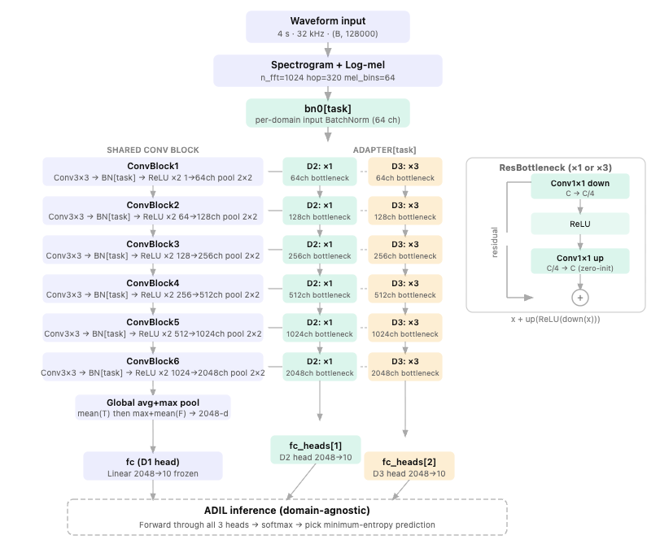

# Asymmetric Residual Adapters for Domain-Incremental Audio Classification

Code for our DCASE 2026 Task 7 submission (**Divakar_IND_task7_1**) and the accompanying DCASE 2026 Workshop paper, *Asymmetric Residual Adapters for Domain-Incremental Audio Classification* ([Google Scholar](https://scholar.google.com/citations?view_op=view_citation&hl=en&user=LKyT6Cd3khkC&citation_for_view=LKyT6Cd3khkC:9yKSN-GCB0IC) · [PDF](workshop_paper/paper.pdf)).

The system extends the official Task 7 ADIL baseline. It adds per-domain residual bottleneck adapters of asymmetric depth (D2 = 1, D3 = 3), a warm-started per-domain classifier head and a supervised contrastive auxiliary loss. These sit on a shared, frozen CNN14 backbone with per-domain BatchNorm. D1 is reproduced exactly, so nothing is forgotten.

**Development-set results (domain-agnostic ADIL inference):**

| System | D2 | D3 | Avg |
|---|---|---|---|
| Baseline (per-domain BN) | 59.2% | 40.8% | 50.0% |
| **Ours (`bn_res_deep_clf`, depths 1,3)** | **76.21%** | **60.79%** | **68.5%** |

On a second DIL benchmark built from TAU Urban Acoustic Scenes 2019 (cities as domains), the same method raises the average accuracy from 52.1% to 73.7% over a per-domain BN baseline trained under the same protocol.



---

## Repository layout

```
code/                     Training code (extends the official Task 7 baseline)
  baseline/               Training entry point and model variants
  utils/                  Config, dataset loaders, utilities
submission/
  Divakar_IND_task7_1/    Challenge submission: meta.yaml, output CSV, standalone model, verify script
  report/                 Technical report (LaTeX)
workshop_paper/           Workshop paper (LaTeX + camera-ready PDF)
  tau2019_experiment/     TAU 2019 cities-as-domains benchmark (see RUNBOOK.md)
  esc50_experiment/       Out-of-domain routing probe on ESC-50
scripts/                  Experiment runners and eval-set inference
results/                  Experiment logs behind the reported numbers
analysis/label_audit/     CLAP / Qwen2-Audio label-noise checks on the Task 7 data
```

---

## Setup

### 1. Install dependencies

```bash
pip install -r code/requirements.txt
```

### 2. Download the dataset

Download the development dataset from [Zenodo](https://zenodo.org/records/19335184) and place it at the repo root:

```
task7_data/
├── audio/
└── evaluation_setup/
    ├── development_train.txt
    └── development_test.txt
```

### 3. Download pretrained checkpoints

Download `checkpoint_D1.pth`, `checkpoint_D2.pth` and `checkpoint_D3.pth` from [Google Drive](https://drive.google.com/drive/folders/1C21s1KlN4ZbnboIdtO8H0T-S0_k8yw3o?usp=sharing) and place them in `pretrained_models/`:

```
pretrained_models/
├── checkpoint_D1.pth
├── checkpoint_D2.pth
└── checkpoint_D3.pth
```

---

## Usage

All commands are run from the repo root.

### Train the submitted system

```bash
python code/baseline/baseline_DIL_task7.py train \
  --model_type bn_res_deep_clf \
  --adapter_depths 1,3 \
  --lambda_con 0.2 \
  --epoch 180 \
  --learning_rate 1e-3 --batch_size 32 --num_workers 4 --cuda --augmentation none \
  --checkpoint_dir checkpoints/BN_RES_DEEP_CLF_lr1e-3_bs32_ep180_deep_clf_d3_ep180 \
  --save
```

### Evaluate a trained model

Add `--resume` to the same command. The script loads the saved checkpoint, skips training, and prints per-domain and per-class accuracy:

```
seen domain: ['D2'] and its accuracy: 77.93
    alarm: 77.7%
    bark: 95.7%
    ...
seen domain: ['D3'] and its accuracy: 58.81
    alarm: 74.2%
    baby_cry: 50.0%
    ...
```

### Run the experiment sweep

```bash
bash scripts/run_experiments.sh 2>&1 | tee runner.log
```

The script resolves the repo root on its own; set `BASE_DIR=/path/to/repo` to override it. Each run gets its own `checkpoints/<experiment_name>/` directory with a `train.log`, and a summary line is appended to `results/experiment_results.txt`:

```
timestamp | experiment_name | D2 accuracy | D3 accuracy | average accuracy | status
```

### Predict on the evaluation set

```bash
python scripts/evaluate_eval_data.py \
  --checkpoint_dir checkpoints/<run> --model_type bn_res_deep_clf --adapter_depths 1,3 --cuda
```

### Verify the submission model

`submission/Divakar_IND_task7_1/` contains a standalone model definition (`Divakar_IND_task7_1_model.py`) and a self-check script. The script needs only PyTorch, not the training codebase. Put the D2/D3 checkpoints in `submission/Divakar_IND_task7_1/checkpoint/`, then run:

```bash
cd submission/Divakar_IND_task7_1
python verify_submission.py
```

The script will:
1. Build the model with the submitted adapter depths.
2. Load `checkpoint/checkpoint_D2.pth` and `checkpoint/checkpoint_D3.pth` with strict key matching.
3. Run a forward pass for every domain on a dummy 4 s / 32 kHz waveform.
4. Run the domain-agnostic entropy-routing inference.

Exit code `0` (`ALL CHECKS PASSED`) means the `.py` and `.pth` files are consistent.

---

## Workshop paper experiments

- **TAU 2019 benchmark:** see [`workshop_paper/tau2019_experiment/RUNBOOK.md`](workshop_paper/tau2019_experiment/RUNBOOK.md). `scripts/run_tau_adil_experiment.sh` runs the full DIL pipeline, and `scripts/run_tau_domain_baselines.sh` runs the per-domain standalone baselines. Logs are in `results/experiment_results_tau_*.txt`.
- **ESC-50 routing probe:** `workshop_paper/esc50_experiment/run_esc50_probe.py` checks how the entropy router behaves on an unseen domain.
- **Label audit:** `analysis/label_audit/` uses CLAP and Qwen2-Audio to flag likely mislabelled clips in the Task 7 data.

---

## Key arguments (`baseline_DIL_task7.py`)

| Argument | Default | Description |
|---|---|---|
| `--model_type` | — | Architecture variant (`bn`, `bn_clf`, `bn_res_deep_clf`, …) |
| `--adapter_depths` | — | Per-domain residual adapter depth, comma-separated (`1,3` → D2=1, D3=3) |
| `--lambda_con` | `0.0` | Supervised contrastive loss weight (submitted: 0.2) |
| `--augmentation` | required | `none` or `mixup` |
| `--learning_rate` / `--batch_size` / `--epoch` | required | Optimisation settings |
| `--checkpoint_dir` | auto | Where checkpoints are saved (default `checkpoints/<auto-name>`) |
| `--save` / `--resume` | off | Save checkpoints / load and evaluate only |
| `--tta_n` | `1` | Test-time augmentation shifts to average |
| `--unfreeze_blocks` | `0` | Unfreeze the top N CNN14 blocks for all domains |
| `--unfreeze_blocks_per_task` | — | Per-domain unfreeze, comma-separated |
| `--lambda_l2_backbone` | `0.0` | L2 anchor toward the previous-domain backbone |
| `--cuda` / `--num_workers` | — | Hardware settings |

---

## Citation

If you use this code, please cite our paper ([Google Scholar](https://scholar.google.com/citations?view_op=view_citation&hl=en&user=LKyT6Cd3khkC&citation_for_view=LKyT6Cd3khkC:9yKSN-GCB0IC)):

```bibtex
@inproceedings{divakar2026asymmetric,
  author    = {Aakash Divakar and Angad Ripudaman Singh Bajwa and Atharva Anand Joshi},
  title     = {Asymmetric Residual Adapters for Domain-Incremental Audio Classification},
  booktitle = {Proceedings of the Detection and Classification of Acoustic Scenes and Events Workshop (DCASE)},
  year      = {2026}
}
```

This work builds on the DCASE 2026 Task 7 baseline (`code/`, see [`code/README.md`](code/README.md)):

```bibtex
@inproceedings{mulimani2025dil,
  author    = {Manjunath Mulimani and Annamaria Mesaros},
  title     = {Domain-Incremental Learning for Audio Classification},
  booktitle = {IEEE International Conference on Acoustics, Speech and Signal Processing (ICASSP)},
  year      = {2025}
}
```

## License

[MIT](LICENSE). The baseline code in `code/` comes from the DCASE 2026 Task 7 organisers; please also credit their work.
